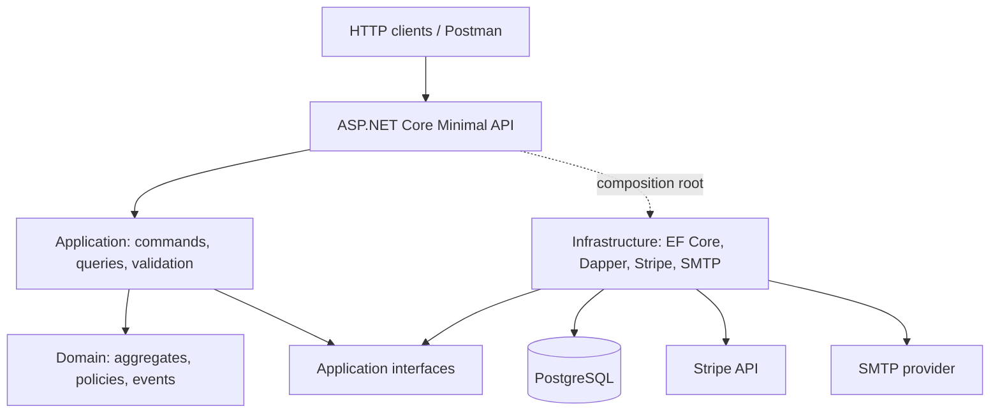

<div align="center">

# BOOKIFY

### A booking engine built for correctness.

**A modular booking and payments backend using .NET 10, PostgreSQL and Clean Architecture.**

From property inventory and date-based pricing to guest checkout, payment reconciliation and reliable background processing.

[](https://github.com/merg8511/Bookify.Services.Booking/actions/workflows/ci.yml)


**[Quick start](#-quick-start)** · **[Architecture](#-architecture)** · **[API](#-api-and-authentication)** · **[Documentation](#-documentation)** · **[Testing](#-testing-and-quality)**

</div>

---

> [!NOTE]
> **Project status:** Bookify is an actively developed backend. This repository contains the Booking service; the Next.js frontend and full deployment stack belong to later roadmap modules. Examples below are intended for **local Development** and isolated test data, not production deployment.

## ✨ What Bookify does

Bookify models a reservation as a business process—not merely a row in a calendar. Availability, prices, ownership, payment status and deadlines must remain consistent even when requests are retried or external systems respond asynchronously.

| Capability | Implementation |
| --- | --- |
| **Properties & inventory** | Property administration, rooms and entire-property rentable units, ownership and capacity rules. |
| **Availability & pricing** | Date-range inventory conflicts, regular/weekend rates, seasonal overrides and immutable booking price snapshots. |
| **Booking lifecycle** | Approval, rejection, customer/guest cancellation, payment deadlines, expiration and completion. |
| **Guest & authenticated access** | OIDC/JWT roles and resource authorization; one-time guest credentials with hashed storage. |
| **Payments** | Stripe PaymentIntents or a development Fake gateway, durable initiation and idempotent retries. |
| **Webhooks** | Signature verification, persisted event deduplication and Booking/Payment reconciliation. |
| **Reliable work** | Domain events, transactional Outbox, notifications, reminders and scheduled background jobs. |
| **Operational visibility** | Structured logs, correlation IDs, OpenTelemetry traces and metrics, health and diagnostics. |

## 🧱 Architecture

The service follows **Clean Architecture** with explicit **CQRS**: EF Core repositories handle transactional writes, while Dapper read services serve specialized queries against the same PostgreSQL database. Application use cases do not depend on a particular HTTP transport.



```text
Bookify.Services.Booking/
├── src/
│   ├── Bookify.Services.Booking.Api/             # Minimal APIs, HTTP security, jobs, OpenAPI
│   ├── Bookify.Services.Booking.Application/     # Commands, queries, handlers, validation
│   ├── Bookify.Services.Booking.Domain/          # Booking, Property, RentableUnit, Payment
│   └── Bookify.Services.Booking.Infrastructure/  # EF Core, Dapper, Stripe, SMTP
├── tests/                                       # Domain, Application and integration tests
├── docs/                                        # Architecture, API, security, operations
├── .github/workflows/                           # CI and release automation
├── Bookify.Services.Booking.slnx
└── global.json
```

**Design principles:** business invariants in Domain; use-case orchestration in Application; adapters in Infrastructure; HTTP contracts and composition in Api; explicit error results for expected failures. See [system and workflow diagrams](docs/architecture/bookify-system-diagrams.md) for sequence and state diagrams.

## ⚡ Quick start

The following commands use **PowerShell** from the repository root on Windows. Adapt paths and shell syntax for other operating systems.

### 1. Requirements

| Tool | Requirement |
| --- | --- |
| **.NET SDK** | `10.0.400` with `latestPatch` roll-forward, as pinned in [`global.json`](global.json). |
| **PostgreSQL** | A running PostgreSQL server and a dedicated development database. |
| **Docker** | Optional for a local PostgreSQL container; **required** to run Testcontainers-based integration tests. |
| **OIDC identity provider** | An HTTPS authority and an audience configured for Bookify. A real JWT is needed for protected routes. |
| **Stripe account / CLI** | Only for end-to-end Stripe tests; normal Development uses the Fake provider. |

```powershell
# Clone and restore
 git clone https://github.com/merg8511/Bookify.Services.Booking.git
 cd Bookify.Services.Booking
 dotnet --version
 dotnet restore Bookify.Services.Booking.slnx
 dotnet tool restore
```

> [!IMPORTANT]
> Run from the solution root so the repository's `global.json` and `dotnet-tools.json` are discovered. The application also requires PostgreSQL and valid identity settings even when using the Fake payment provider.

### 2. Start PostgreSQL

Use an existing PostgreSQL instance, **or** run this local-only example with Docker:

```powershell
# Example local credentials; change before using anywhere outside an isolated dev machine.
docker volume create bookify-pgdata

docker run -d `
  --name bookify-postgres `
  -e POSTGRES_DB=bookify_dev `
  -e POSTGRES_USER=bookify `
  -e POSTGRES_PASSWORD=change-me-local-only `
  -p 127.0.0.1:5432:5432 `
  -v bookify-pgdata:/var/lib/postgresql/data `
  postgres:16

docker ps --filter "name=bookify-postgres"
```

`postgres:16` is a **local development example**, not an official deployment image/version policy. If port `5432` is occupied, use your own PostgreSQL instance or adjust the host port and connection string. To stop the example: `docker stop bookify-postgres`; to restart it: `docker start bookify-postgres`.

### 3. Configure Development secrets

The API's `.csproj` already defines a **UserSecretsId**. Use [.NET User Secrets](https://learn.microsoft.com/aspnet/core/security/app-secrets) rather than committing passwords, JWTs, SMTP credentials or Stripe keys.

```powershell
$api = "src/Bookify.Services.Booking.Api"

# Example uses the disposable PostgreSQL credentials above.
dotnet user-secrets set "ConnectionStrings:Database" `
  "Host=localhost;Port=5432;Database=bookify_dev;Username=bookify;Password=change-me-local-only" `
  --project $api

# Replace both placeholders with your actual identity provider configuration.
dotnet user-secrets set "Identity:Authority" `
  "https://YOUR-IDP.example/realms/YOUR-REALM" --project $api

dotnet user-secrets set "Identity:Audience" `
  "YOUR-BOOKIFY-API-AUDIENCE" --project $api
```

The API validates that `Identity:Authority` is an **absolute HTTPS URL** and that `Identity:Audience` is nonempty. Authentication uses OIDC/JWT and resource-based authorization; Bookify does not issue access tokens through a login endpoint of its own.

> [!CAUTION]
> `dotnet user-secrets` is a development convenience, **not an encrypted production secret vault**. Never commit exported values, completed Postman environments, `sk_test_` / `sk_live_` keys, `whsec_` secrets or `Booking-Guest-Token` values.

### 4. Apply migrations

The repo pins `dotnet-ef` in [`dotnet-tools.json`](dotnet-tools.json). Apply the migrations that already exist; **do not** generate a new migration merely to start the service.

```powershell
dotnet ef migrations list `
  --project src/Bookify.Services.Booking.Infrastructure `
  --startup-project src/Bookify.Services.Booking.Api `
  --context BookingDbContext

dotnet ef database update `
  --project src/Bookify.Services.Booking.Infrastructure `
  --startup-project src/Bookify.Services.Booking.Api `
  --context BookingDbContext
```

Run these commands against your **development database only**. Review generated migrations before applying them to an existing populated database; operational upgrade/deployment migration procedures are tracked in the roadmap's Module 29.6.

### 5. Run the API

```powershell
dotnet dev-certs https --trust

dotnet run `
  --project src/Bookify.Services.Booking.Api `
  --launch-profile https
```

| Endpoint | Development URL |
| --- | --- |
| Health | [`https://localhost:7071/health`](https://localhost:7071/health) |
| Interactive API reference (Scalar) | [`https://localhost:7071/scalar`](https://localhost:7071/scalar) |
| Native OpenAPI document | [`https://localhost:7071/openapi/v1.json`](https://localhost:7071/openapi/v1.json) |
| Database diagnostic | [`https://localhost:7071/diagnostics/database`](https://localhost:7071/diagnostics/database) |

The `https` launch profile also binds `http://localhost:5148`; HTTPS redirection applies in Development. **Scalar and OpenAPI are registered in Development and Testing only; diagnostic endpoints are Development-only. Neither Scalar nor OpenAPI is exposed in Production.** The local links work only while the API is running on your machine.

## 🔐 Configuration reference

.NET configuration accepts `appsettings.json`, development User Secrets and environment variables. For nested keys in environment variables, use **double underscores (`__`)**; e.g. `Payments__Provider` corresponds to `Payments:Provider`. **An `.env` file is not loaded automatically by this application.**

| Key | Purpose / important behavior |
| --- | --- |
| `ConnectionStrings:Database` | **Required.** Npgsql/PostgreSQL connection string. |
| `Identity:Authority` | **Required.** HTTPS OIDC issuer/authority, e.g. your identity realm. |
| `Identity:Audience` | **Required.** Accepted JWT audience for this API. |
| `Payments:Provider` | `Fake` in `Development`/`Demo` settings; switch to `Stripe` only when intentionally testing the provider. |
| `Payments:Stripe:SecretKey` | Required when `Payments:Provider=Stripe`; never commit a real value. |
| `Payments:Stripe:WebhookSecret` | Required with Stripe; for local forwarding use the `whsec_...` printed by `stripe listen`. |
| `Payments:Stripe:WebhookToleranceSeconds` | Signature timestamp tolerance; default `300`. |
| `Notifications:Smtp:Enabled` | `false` by default; set `true` only after valid SMTP configuration. |
| `Notifications:Smtp:Host` / `Port` / `Security` | Server, port (default `587`) and MailKit security mode (`StartTls` by default). |
| `Notifications:Smtp:FromAddress` / `FromName` | Sender address and display name; required when SMTP is enabled. |
| `Notifications:Smtp:Username` / `Password` | Optional authentication, but configure **both or neither**. |
| `BackgroundJobs:Enabled` | Worker enabled by default; set `false` for controlled local debugging. |
| `BackgroundJobs:PollingInterval` / `BatchSize` | Default `00:00:10` / `50`. |
| `BookingDeadlines:ApprovalWindow` / `PaymentWindow` | Default `1.00:00:00` / `00:30:00`. |
| `DemoSeed:Enabled` | `false` by default; explicitly opt in in `Development` or `Demo` only. |
| `DemoSeed:OwnerSubjectId` | Required to create the owner-scoped demo property when seed is enabled. |
| `DemoSeed:CustomerSubjectId` | Optional; enables the authenticated-customer demo batch. |
| `HttpSecurity:TrustedFrontendOrigins` | Allowed browser origins; local Development includes `http://localhost:3000`. |
| `Observability:Exporters:Tracing` / `Metrics` | Optional OTLP exporter settings; disabled unless configured. |

Full nonsecret defaults—including PostgreSQL/request timeouts, rate limits, reminders and Outbox retry rules—are in [`appsettings.json`](src/Bookify.Services.Booking.Api/appsettings.json). Development overrides are in [`appsettings.Development.json`](src/Bookify.Services.Booking.Api/appsettings.Development.json).

### Stripe: Fake versus real test mode

**Default development path:** `Payments:Provider=Fake` allows the Booking → approval → payment initiation flow without calling Stripe. The Fake gateway returns a pending attempt; **initiating a payment does not mark a Booking as Paid**.

For Stripe integration tests, use `Payments:Provider=Stripe`, a **test-mode** `sk_test_...` key and the webhook signing secret from Stripe CLI. Confirming a real test PaymentIntent and receiving a matching, valid webhook are separate steps. See the full [Stripe CLI / local webhook guide](docs/payments/stripe-cli-local-webhooks.md).

```powershell
# Session-local override; not written to appsettings.json.
$env:Payments__Provider = "Stripe"

# Set Payments__Stripe__SecretKey and Payments__Stripe__WebhookSecret
# securely in this terminal, following the Stripe CLI guide.
```

The Stripe webhook accepts `POST /api/v1/payments/webhooks/stripe` with a valid `Stripe-Signature` and the original raw JSON body. Supported mapped events include `payment_intent.succeeded`, `payment_intent.payment_failed` and `payment_intent.canceled`. An unrelated, valid test webhook does **not** imply that any Bookify reservation was paid.

### SMTP and background processing

SMTP delivery is **disabled by default**. When you enable it, configure `Host`, `Port`, `Security`, `FromAddress`, `FromName` and any matching username/password credentials using secrets. The application validates required settings at startup. When delivery is disabled, Outbox notifications may be deferred instead of being reported as delivered.

The `BookingBackgroundWorker` processes approval/payment expiration, booking completion, Outbox notifications, payment-deadline reminders and upcoming-check-in reminders. This worker is controlled by `BackgroundJobs:Enabled`; it is not a separate deployed worker service in the current repository.

## 🧪 Demo seed (opt-in)

An **idempotent, versioned demo seed** creates a property, rentable units, pricing/season scenarios and example bookings/payment states. The ledger (`demo_seed_batches`) ensures a batch is applied once rather than overwriting existing demo data every startup.

```powershell
$api = "src/Bookify.Services.Booking.Api"

dotnet user-secrets set "DemoSeed:OwnerSubjectId" `
  "YOUR-REAL-OIDC-OWNER-SUBJECT" --project $api

dotnet user-secrets set "DemoSeed:Enabled" "true" --project $api

# Optional: create the authenticated-customer batch.
# dotnet user-secrets set "DemoSeed:CustomerSubjectId" `
#   "YOUR-REAL-OIDC-CUSTOMER-SUBJECT" --project $api
```

**Guardrails:** seed runs only in `Development` or `Demo`; enabling it in `Testing`, `Staging` or `Production` is rejected. Apply all migrations **before** enabling it. Use a disposable database, not customer data. Its sample Payment/Attempt records do not represent Stripe charges. Guest tokens generated by the seed cannot be recovered in plaintext.

Demo dates are fixed when the corresponding batch first runs; the seed **does not continuously regenerate future dates**. For current, valid guest-access tests, use the HTTP checkout flow in Postman rather than trying to recover a seeded guest token.

To return to the default local behavior:

```powershell
dotnet user-secrets set "DemoSeed:Enabled" "false" `
  --project src/Bookify.Services.Booking.Api
```

## 🌐 API and authentication

All business endpoints are grouped under **`/api/v1`**. The native OpenAPI document describes the implemented operations, request/response schemas, and special security contracts. In Development, browse and try operations via the [Scalar interactive API reference](docs/api/interactive-reference.md) at `/scalar`; Scalar uses the existing document without changing its API contracts.

| Area | Example operation | Access model |
| --- | --- | --- |
| Properties | `GET /api/v1/properties` | Public |
| Property administration | `POST /api/v1/properties` | Owner / Admin JWT |
| Availability | `GET /api/v1/properties/{propertyId}/availability` | Public |
| Booking creation | `POST /api/v1/bookings` | Public; required `Idempotency-Key` |
| Booking access | `GET /api/v1/bookings/{identifier}` | Authorized customer **or** Guest credential |
| Payment initiation | `POST /api/v1/payments` | Authorized customer **or** Guest credential; required `Idempotency-Key` |
| Payment status | `GET /api/v1/payments/bookings/{bookingId}/status` | Authorized customer **or** Guest credential |
| Stripe webhook | `POST /api/v1/payments/webhooks/stripe` | Signed Stripe event |
| Admin bookings | `GET /api/v1/admin/properties/{propertyId}/bookings` | Authorized property owner / Admin |

**JWT:** Identity provider tokens are checked for issuer, audience, lifetime and signature. Protected resources also enforce ownership and/or role rules; a syntactically valid token is not sufficient for every resource.

**Guest access:** anonymous checkout issues `Booking-Guest-Token` in the **initial `201 Created` response header only**. The API stores only a hash; it cannot return the original token later, including on idempotency replay. Protect the value as a credential.

**Error contract:** expected failures use RFC 9457-style `application/problem+json` with standard Problem Details fields and Bookify extensions such as `code` and `traceId` when applicable. Rate limits return `429`; `Retry-After` can be included when available.

**Booking lifecycle:** `PendingApproval → PendingPayment → Paid → Completed`, with supported rejection, cancellation and expiration paths. Payments and attempts have **their own** statuses; they are reconciled, not blindly copied to Booking.

## ✅ Testing and quality

The repository includes Domain, Application and Integration tests based on **xUnit v3**. Integration tests start isolated PostgreSQL instances with **Testcontainers**, so Docker must be running.

```powershell
# Ensure Docker engine is available for integration tests.
docker info

# Restore, compile and test the solution.
dotnet restore Bookify.Services.Booking.slnx
dotnet build Bookify.Services.Booking.slnx -c Release
dotnet test Bookify.Services.Booking.slnx -c Release

# Verify formatting without changing source files.
dotnet format Bookify.Services.Booking.slnx --verify-no-changes
```

CI additionally audits NuGet dependencies and collects **Cobertura** test coverage reports. Inspect [GitHub Actions](https://github.com/merg8511/Bookify.Services.Booking/actions) for current runs; the badge above reflects the `main` workflow, not unmerged local changes.

For a guided HTTP smoke test, import the [Postman collection and environment](docs/postman/README.md). The Módulo 24.3 run was reported with **44 passing assertions** on 2026-11-04. That execution evidence is separate from the full .NET test suite.

## 🐳 Docker and deployment boundary

Docker is useful **today** to run local PostgreSQL and to provide the daemon required by Testcontainers. The inspected repository snapshot does **not** contain a completed production `Dockerfile` or `docker-compose.yml`; this README intentionally does not invent `docker compose up` instructions.

The complete container composition and deployment verification belong to **Módulo 29.4 — Docker Compose completo**, while database upgrade operations belong to **Módulo 29.6 — Migraciones**. Review environment-specific secrets, TLS, identities and infrastructure before any real deployment.

## 📚 Documentation

| Resource | What's inside |
| --- | --- |
| **[Architecture & workflow diagrams](docs/architecture/bookify-system-diagrams.md)** | Layers, CQRS, Booking lifecycle, pricing, payments, webhooks, Outbox/jobs, auth and observability. |
| **[REST conventions](docs/api/rest-conventions.md)** | HTTP API conventions and contract organization. |
| **[Interactive API reference (Scalar)](docs/api/interactive-reference.md)** | Developer UI, local setup, authentication, CSP nonce and testing. |
| **[Endpoint access matrix](docs/security/endpoint-access-matrix.md)** | Access requirements by endpoint. |
| **[Guest credential model](docs/security/guest-access.md)** | Guest ownership, credential issuance and verification. |
| **[HTTP security](docs/security/http-security.md)** | Headers, CORS and request boundary protections. |
| **[Rate limiting](docs/security/rate-limiting.md)** | Request rate-limit policies and responses. |
| **[Postman flow & environment](docs/postman/README.md)** | Guided end-to-end HTTP collection. |
| **[Stripe CLI local webhooks](docs/payments/stripe-cli-local-webhooks.md)** | Forwarding, signature tests and real reconciliation. |
| **[Architectural Decision Records (ADRs)](docs/architecture/adr/README.md)** | Nine records covering persistence, CQRS, concurrency, idempotency, payments, Outbox, jobs, OIDC and project dependencies. |
| **[Test inventory](docs/testing/test-coverage-inventory.md)** | Existing automated test coverage. |
| **[CHANGELOG](CHANGELOG.md)** | Version/release history. |

The [Architectural Decision Records](docs/architecture/adr/README.md) document the implemented decisions and explicitly record the Api→Domain project reference. The OpenAPI/documentation contract suite was implemented in **Módulo 24.8**; Scalar integration and its dedicated checks are tracked in **Módulos 24.9–24.10**.

## 🗺️ Development roadmap

The repository is being developed incrementally, module by module. The current documentation work covers **Módulo 24 — OpenAPI and documentation**. The subsequent frontend foundation and operational deployment phases are separate deliverables; they should not be mistaken for features already present in this backend.

---

<div align="center">

**Bookify Services Booking** · Designed around explicit business rules, repeatable workflows and observable operations.

[Repository](https://github.com/merg8511/Bookify.Services.Booking) · [CI](https://github.com/merg8511/Bookify.Services.Booking/actions) · [Documentation](docs/architecture/bookify-system-diagrams.md)

</div>
