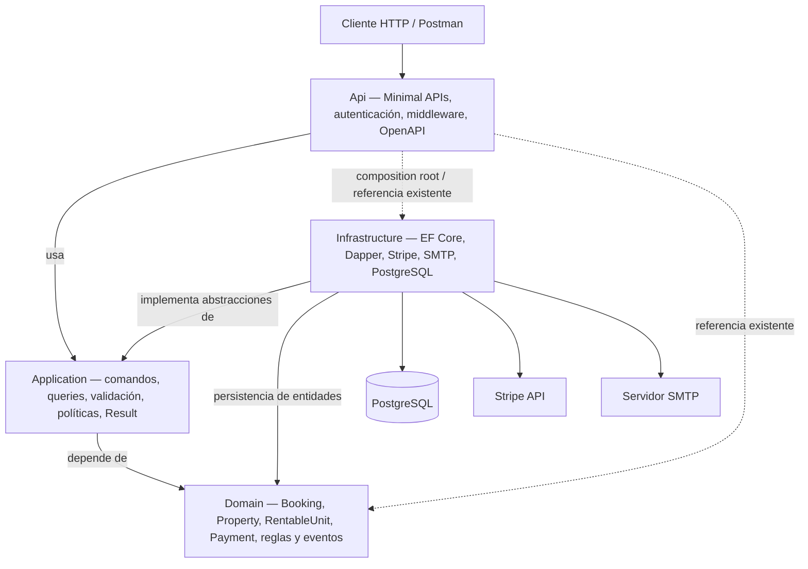
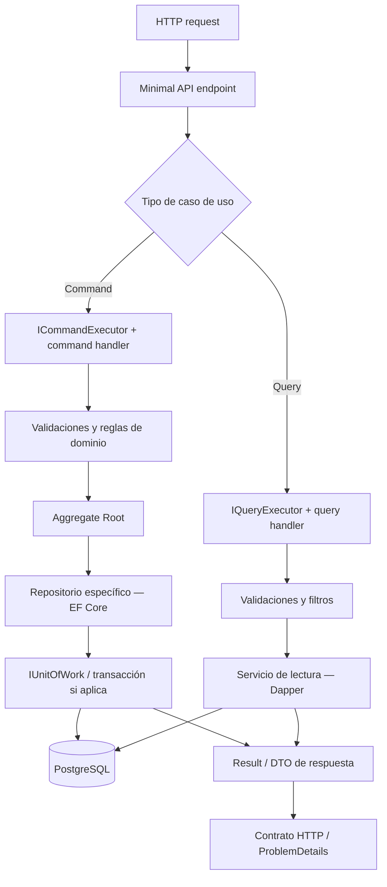
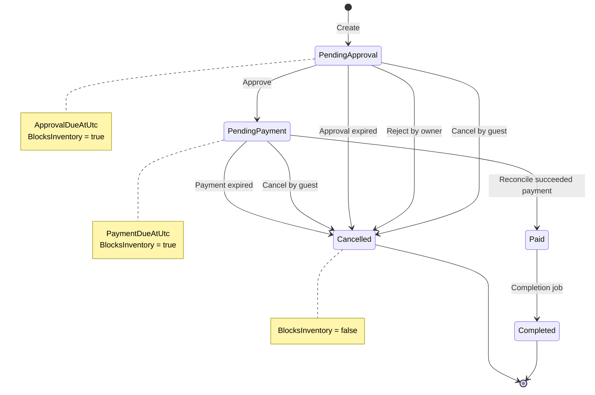
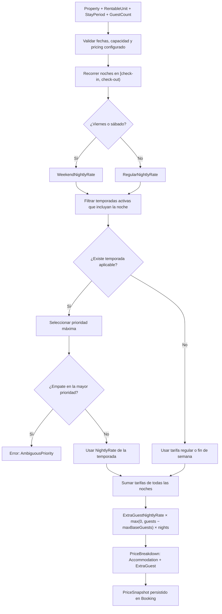
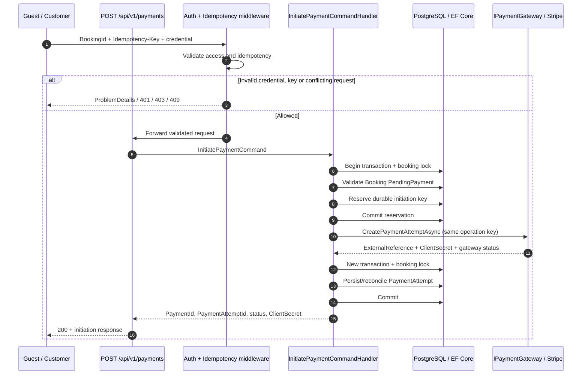
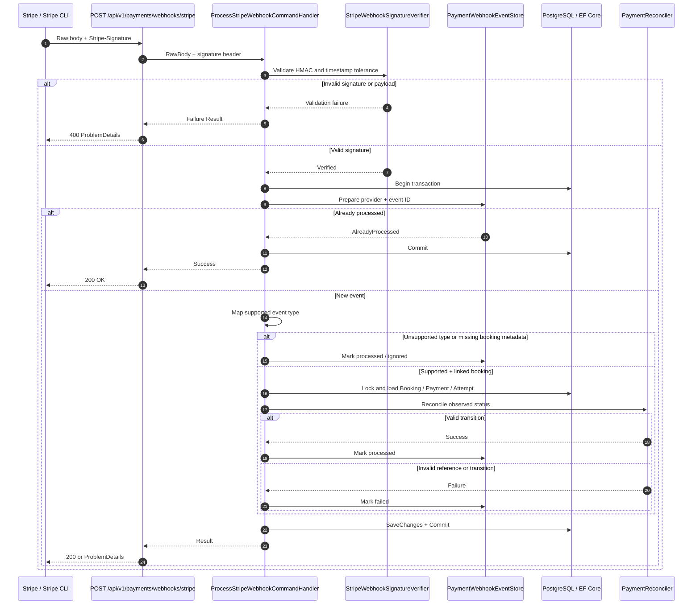
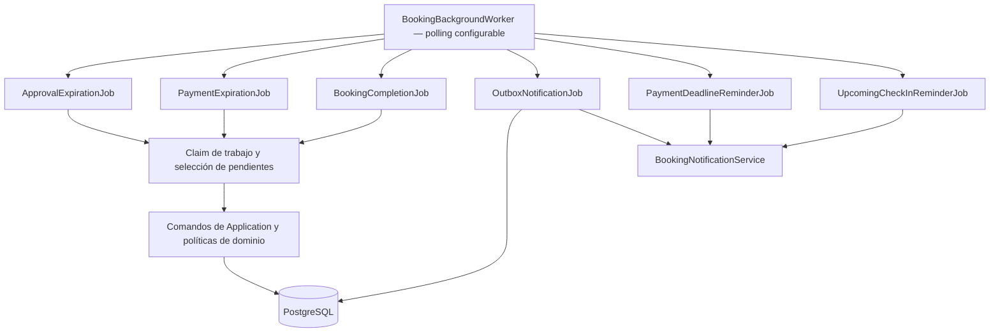
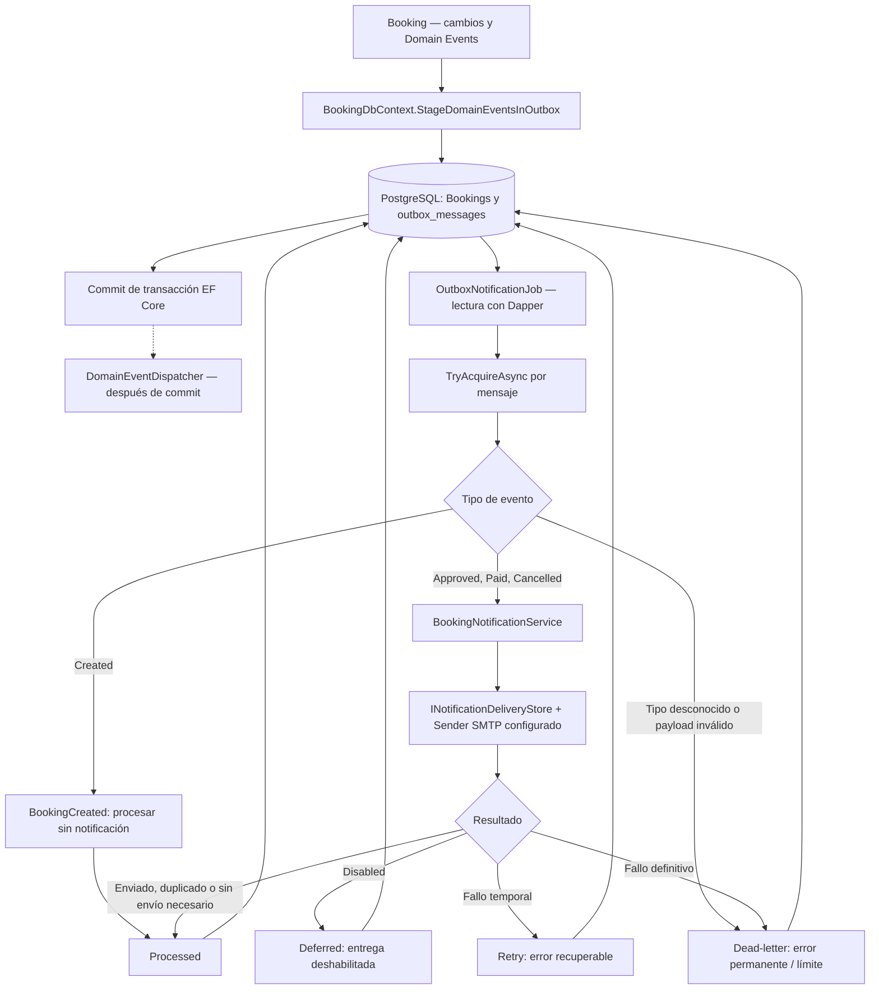
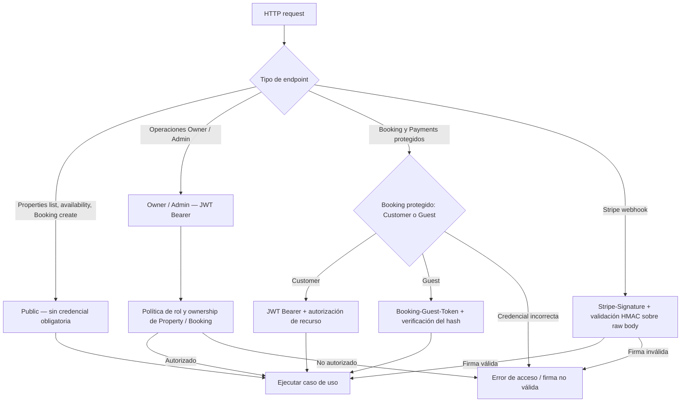
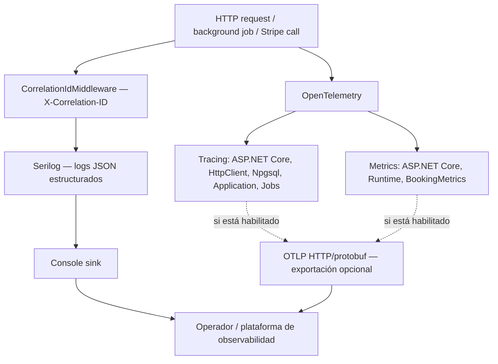

# Bookify — Diagramas de arquitectura y flujos

> **Módulo:** 24.5 — Diagramas  
> **Servicio:** `Bookify.Services.Booking` (.NET 10, Minimal APIs)  
> **Alcance:** backend existente hasta el Módulo 24.4, sin adelantar el frontend.  
> **Formato:** Mermaid, renderizable y versionable en GitHub Markdown.

## Cómo leer este documento

Los diagramas representan **comportamientos implementados**; no son un diseño de funcionalidades pendientes. Las flechas de dependencia entre proyectos se distinguen de los mensajes de ejecución en los diagramas de secuencia.

Secciones: [1. Capas](#1-capas-y-dependencias) · [2. CQRS](#2-cqrs-lecturas-y-escrituras) · [3. Booking](#3-ciclo-de-vida-de-booking) · [4. Pricing](#4-cálculo-de-precios) · [5. Pago](#5-secuencia-de-iniciación-de-pago) · [6. Webhook](#6-secuencia-de-webhook-stripe) · [7. Outbox/jobs](#7-outbox-notificaciones-y-background-jobs) · [8. Autorización](#8-autenticación-y-autorización) · [9. Observabilidad](#9-observabilidad).

### Convenciones

- **Commands:** modifican estado; utilizan los casos de uso de Application, el dominio y los repositorios EF Core.
- **Queries:** consultan modelos de lectura a través de interfaces de Application e implementaciones Dapper de Infrastructure.
- **Result:** errores de negocio que se convierten a respuestas HTTP; los errores inesperados se manejan globalmente.
- **PostgreSQL:** almacena entidades, pagos, idempotencia, outbox y entregas de notificaciones.
- **Stripe:** proveedor de pago externo; sus eventos no son equivalentes a una transición aceptada de Booking.

---

## 1. Capas y dependencias

**Lectura:** las dependencias de código no implican que Domain conozca ASP.NET Core, PostgreSQL o Stripe. La API registra las implementaciones de Infrastructure mediante DI. El proyecto API posee referencias directas a Application, Infrastructure y Domain; no ocultamos esa dependencia existente. Su justificación arquitectónica se documentará en el **Módulo 24.7 — ADRs**.

**Código de referencia:** `Api/Program.cs`, `Application/`, `Domain/`, `Infrastructure/Persistence/BookingDbContext.cs`, `Infrastructure/Payments/PaymentsDependencyInjection.cs`.

## 2. CQRS: lecturas y escrituras

**Lectura:** CQRS es **manual**: interfaces `ICommandExecutor` / `IQueryExecutor`, handlers específicos y servicios de lectura. No se usa un bus de mensajes ni se presupone un modelo de lectura separado físicamente; ambos lados consultan la misma base PostgreSQL mediante mecanismos distintos. Algunos comandos utilizan lecturas auxiliares o bloqueos transaccionales cuando una regla lo necesita.

**Código de referencia:** `Application/Abstractions/Messaging/`, `Infrastructure/Persistence/Repositories/`, `Infrastructure/Persistence/ReadServices/`, `Api/Endpoints/`.

## 3. Ciclo de vida de Booking

**Invariantes verificadas:** `Booking.Cancel()` permite cancelar únicamente `PendingApproval` o `PendingPayment`. No hay transición pública `Paid → Cancelled`. `Completed` sigue teniendo `BlocksInventory = true` en el agregado; la disponibilidad evalúa también el intervalo solicitado. `RejectedByOwner`, `ApprovalExpired`, `PaymentExpired` y `CancelledByGuest` son razones de cancelación, no nuevos estados.

**Código de referencia:** `Domain/Bookings/Booking.cs`, `Domain/Bookings/BookingStatus.cs`, `Application/Bookings/Approve/`, `Application/Bookings/ExpireApproval/`, `Application/Bookings/ExpirePayment/`, `Application/BackgroundJobs/Completion/`.

## 4. Cálculo de precios

**Lectura:** el motor decide la tarifa **por noche**; viernes y sábado son las noches consideradas de fin de semana. Solo las temporadas activas aplican; un empate en prioridad máxima produce error, no una elección arbitraria. El extra por huésped se calcula por cantidad de noches, sin tarifa estacional adicional. Una reserva almacena su `PriceSnapshot`; no sustituimos el precio confirmado por un cálculo nuevo al iniciar el pago.

**Código de referencia:** `Domain/Bookings/Services/BookingPricingEngine.cs`, `WeekendPricingPolicy.cs`, `SeasonPricingPolicy.cs`, `Domain/Bookings/Pricing/PriceSnapshot.cs`, `Domain/Properties/Pricing/RentableUnitPricing.cs`.

## 5. Secuencia de iniciación de pago

**Lectura:** Bookify preserva una identidad de operación duradera **antes** de llamar a Stripe, por lo que un timeout no debe provocar automáticamente una nueva operación con otra clave. La llamada externa ocurre **fuera** de la transacción inicial. `Payment` y `PaymentAttempt` son entidades separadas; `ClientSecret` es sensible y no debe registrarse ni mostrarse en diagramas con valores reales. El estado inicial habitual puede ser `Pending`: no indica pago confirmado.

**Código de referencia:** `Application/Payments/Initiate/InitiatePaymentCommandHandler.cs`, `Infrastructure/Payments/Stripe/StripePaymentGateway.cs`, `Api/Idempotency/IdempotencyMiddleware.cs`.

## 6. Secuencia del webhook de Stripe

**Lectura:** las firmas se verifican contra el **cuerpo original**. Solo se reconocen `payment_intent.succeeded`, `payment_intent.payment_failed` y `payment_intent.canceled` para reconciliación; otros tipos verificados se registran como procesados sin forzar una transición. La relación se verifica mediante `bookify_booking_id` y el `PaymentIntent.Id` correspondiente al `PaymentAttempt.ExternalReference`. Los webhooks duplicados ya procesados no deben repetir efectos. Un evento de prueba sin relación con una reserva no demuestra un pago exitoso de Bookify.

**Código de referencia:** `Api/Endpoints/Payments/Webhooks/StripePaymentWebhookEndpoint.cs`, `Application/Payments/Webhooks/Stripe/ProcessStripeWebhookCommandHandler.cs`, `StripeWebhookEventTypes.cs`, `Infrastructure/Payments/Stripe/StripeWebhookSignatureVerifier.cs`, `Application/Payments/Reconciliation/PaymentReconciler.cs`.

## 7. Outbox, notificaciones y background jobs

### 7.1 Jobs programados

El worker ejecuta **seis jobs existentes**, con `PollingInterval`, `BatchSize` y ámbitos de DI independientes. Los jobs de expiración y finalización seleccionan y reclaman trabajo antes de ejecutar comandos; los recordatorios usan sus propias selecciones. En este esquema se omiten deliberadamente algunos detalles de cada claim para mantener la lectura clara.

### 7.2 Outbox y entrega confiable

**Lectura:** el Outbox se incorpora al `SaveChanges` de EF Core y se guarda junto al agregado; en las transacciones explícitas, el despacho de eventos en memoria sucede después del commit. El `OutboxNotificationJob` lee pendientes mediante Dapper, obtiene claims para reducir concurrencia y administra estados `Processed`, reintento, diferimiento y dead-letter. `BookingCreatedDomainEvent` se marca procesado sin notificación; los eventos `Approved`, `Paid` y `Cancelled` se traducen a notificaciones.

**Importante:** el envío SMTP no es parte de la transacción que creó o aprobó la reserva. `INotificationDeliveryStore` evita envíos repetidos cuando ya existe una entrega registrada, pero no supone garantía absoluta de exactamente una entrega ante cualquier fallo externo.

**Código de referencia:** `Infrastructure/Persistence/BookingDbContext.cs`, `Infrastructure/Persistence/Transactions/EfCoreTransactionManager.cs`, `Api/BackgroundJobs/BookingBackgroundWorker.cs`, `Application/BackgroundJobs/Notifications/OutboxNotificationJob.cs`, `Application/Notifications/BookingNotificationService.cs`.

## 8. Autenticación y autorización

**Lectura:** la autorización de Booking consulta el recurso específico; disponer de un JWT válido no concede automáticamente acceso a una reserva ajena. Una reserva Guest almacena el **hash** de la credencial y devuelve el token en claro **una única vez** en el header de creación `Booking-Guest-Token`. La consulta pública de `BookingReference` por sí sola no demuestra propiedad. Los webhooks no requieren JWT Bearer, sino su firma. En los endpoints documentados como `Customer OR Guest`, las credenciales son alternativas, no obligatorias simultáneamente.

**Código de referencia:** `Api/Security/EndpointAccessExtensions.cs`, `Api/Security/Authorization/`, `Api/Security/BookingGuestAccessHeader.cs`, `Api/Security/IdentityDependencyInjection.cs`, `Domain/Bookings/Booking.cs`.

## 9. Observabilidad

**Lectura:** `X-Correlation-ID` correlaciona las solicitudes y forma parte de la respuesta HTTP; el enriquecedor de Serilog agrega contexto de trazas a los logs JSON. OpenTelemetry instrumenta ASP.NET Core, HTTP y Npgsql, además de los `ActivitySource` propios de Application y background jobs, y el `Meter` de métricas de Bookify. Los exportadores OTLP se habilitan **solo por configuración**; este diagrama no presupone que exista un collector o dashboard desplegado.

**Código de referencia:** `Api/Observability/CorrelationIdMiddleware.cs`, `RequestLoggingMiddleware.cs`, `SerilogDependencyInjection.cs`, `OpenTelemetryDependencyInjection.cs`, `Application/Observability/BookingMetrics.cs`.

---

## Relación con otros submódulos del Módulo 24

- **24.1 — OpenAPI:** inventario HTTP; el diagrama de capas y CQRS ubica esos endpoints.
- **24.2 — Contratos especiales:** los diagramas 5, 6 y 8 ilustran idempotencia, autorización y firma Stripe.
- **24.3 — Postman:** el recorrido Property → Booking → Approval → Payment → Status se corresponde con los flujos de la colección.
- **24.4 — Stripe CLI:** el diagrama 6 explica el forwarding y la reconciliación que la guía permite probar.
- **24.6 — README:** deberá enlazar este documento, no duplicar todos los diagramas.
- **24.7 — ADRs:** documentará las decisiones y sus consecuencias, incluida la dependencia directa `Api → Domain`.
- **24.8 — Tests de OpenAPI y documentación:** verificará cobertura y consistencia de documentación y contratos.

## Alcance y límites

- Este documento **no** describe un frontend Next.js ya implementado ni nuevas APIs; eso pertenece a los módulos posteriores del roadmap.
- Las flechas de los flowcharts expresan responsabilidades y relaciones conceptuales; los diagramas de secuencia describen el orden relevante de las llamadas.
- La inicialización de pagos Stripe no es una confirmación de cobro. El estado se confirma por reconciliación con el proveedor.
- Los estados de reserva y pagos son agregados distintos: no intercambiar `BookingStatus` con `PaymentStatus` o `PaymentAttemptStatus`.
- Ningún diagrama contiene tokens Guest, claves Stripe, secretos SMTP o cadenas de conexión reales.
